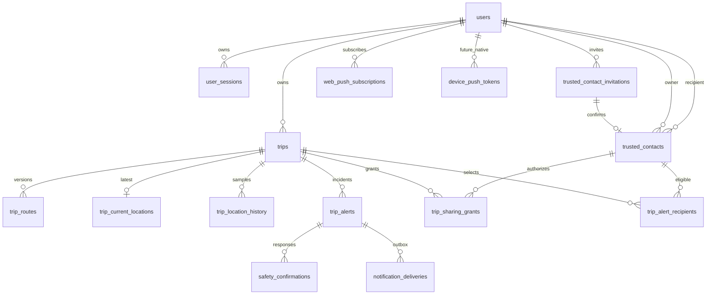

# ERD / schema

Migration Phase 1 tạo users, user_sessions, trusted_contact_invitations và trusted_contacts. Những bảng khác dưới đây là thiết kế cho phase tiếp theo, chưa phải tính năng đang chạy.

## Phase 1

- `users`: UUID PK; email canonical unique; password_hash (Argon2id); display_name; created_at/updated_at TIMESTAMPTZ.
- `user_sessions`: UUID PK, user_id FK ON DELETE CASCADE, token_hash BYTEA UNIQUE (32 bytes), device_name, created_at, last_seen_at, expires_at, revoked_at. User index cho quản lý phiên; không trả hash ra API.
- `trusted_contact_invitations`: UUID PK, owner_id FK, invitee_email canonical, token_hash BYTEA UNIQUE, status PENDING/ACCEPTED/DECLINED/CANCELED/EXPIRED; created_at, expires_at, responded_at. Partial unique `(owner_id, invitee_email) WHERE status='PENDING'`; index email cho inbox. Email là địa chỉ được mời, không giả định đã có user. Thông tin phản hồi chỉ thay đổi trong transaction.
- `trusted_contacts`: UUID PK, owner_id/contact_user_id FK, invitation_id FK, UNIQUE(owner_id, contact_user_id), CHECK owner != contact, confirmed_at, revoked_at; label TEXT mặc định rỗng, tối đa 80 ký tự, owner sửa được. Index contact_user_id cho quyền thu hồi từ phía người nhận. Không có cột GPS hoặc grant mặc định.

## Thiết kế Phase 2–5

Mọi entity dùng UUID trừ composite PK cho time-series. Thời gian dùng TIMESTAMPTZ, serialize RFC3339 UTC; tọa độ GeoJSON luôn `[longitude, latitude]`.

- `trips`: owner_id, status, tracking_status, selected_recipient_ids được chuẩn hóa vào bảng recipients/grants, started_at, ended_at, last_heartbeat_at, last_gps_at. Một chuyến ACTIVE/người dùng bằng partial unique index.
- `trip_routes`: trip_id, version, route geometry(LineString,4326), corridor_meters, confirmed_at; index/unique `(trip_id,version)`. Query `ST_DWithin(route::geography, point::geography, meters)`; geography tính mét, không dùng độ làm mét. Geometry index geography expression chỉ thêm nếu truy vấn thực tế cần; kiểm tra một tuyến theo trip PK không đòi full spatial scan.
- `trip_current_locations`: trip_id PK/FK, route_version, position geography(Point,4326), accuracy, speed nullable, heading nullable, recorded_at, received_at. Cập nhật chỉ nếu recorded_at mới hơn; sample ID giúp tie-break/dedup.
- `trip_location_history`: trip_id, sample_id, recorded_at partition key, received_at, position, accuracy/speed/heading; PK `(trip_id,recorded_at,sample_id)`; index `(trip_id,recorded_at DESC)` nếu PK không đáp ứng truy vấn đã đo. Hypertable theo recorded_at; không UNIQUE sample_id đơn lẻ. Chặn timestamp không hợp lệ/tương lai quá mức; GPS đến trễ chỉ thêm lịch sử, không lùi vị trí hiện tại hoặc tạo alert realtime.
- `trip_alerts`: trip_id, kind (SOS/DEVIATION/CONTACT_LOSS), state, opened_at, deadline_at, escalated_at, resolved_at, route_version, idempotency_key. Partial unique cho incident đang mở cùng trip/kind. Claim timeout/outbox qua transaction `FOR UPDATE SKIP LOCKED`.
- `safety_confirmations`: alert_id, user_id, response SAFE/HELP/ROUTE_CHANGE, responded_at; unique xử lý một phản hồi hợp lệ/alert, kiểm tra owner.
- `notification_deliveries`: alert_id, recipient_id, channel, status, attempts, next_attempt_at, lease_until, provider_message_id, error_code, deduplication_key UNIQUE. Không thể bảo đảm exactly-once với mọi provider; chống trùng nội bộ + idempotency provider nếu hỗ trợ.
- `web_push_subscriptions`: user_id, endpoint unique, p256dh/auth secret, active/revoked_at; mã hóa secret ở rest khi triển khai. `device_push_tokens` dành phase native.
- `trip_sharing_grants`: trip_id, contact_id, reason MANUAL/ALERT, granted_at, expires_at, revoked_at, alert_id nullable. Không tạo active grant khi bắt đầu chuyến trừ khi owner chia sẻ. End trip/revoke/expiry chặn cả REST và WS. Chọn người nhận cảnh báo không đồng nghĩa cấp quyền xem trước sự cố.
- `trip_alert_recipients`: trip_id/contact_id composite PK, selected_at; danh sách người nhận được owner chọn cho mỗi chuyến. Chỉ grant MANUAL hoặc alert ESCALATED mới mở quyền xem, không suy quyền từ bảng recipients.

## Retention

GPS thông thường tối đa 30 ngày; cleanup job dùng chunk retention khi phù hợp. Tách dữ liệu sự cố cần giữ theo chính sách riêng trước khi bật retention tự động (không dùng drop_chunks làm mất sự cố). Quy trình xóa tài khoản và hành trình ở phase 5, kèm kiểm tra backup/retention. Không tự đặt thời hạn dài cho dữ liệu sự cố khi chưa có quyết định sản phẩm.
